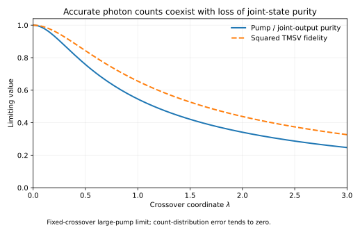

# Quantum Pump State Crossover

**Accurate photon counts can coexist with a nearly orthogonal quantum-state prediction.**

When does a bright coherent pump justify replacing a quantum mode by a classical
amplitude? In resonant parametric down-conversion, the answer depends on what
is measured. Complete pair counts and individual thermal marginals can become
asymptotically accurate while the joint signal–idler state remains mixed and
non-Gaussian. Along sequences with a diverging crossover parameter inside an
explicitly controlled window, its trace distance from **every pure state**
tends to one even as fractional pump depletion vanishes.

| Read next | Purpose |
|---|---|
| [Tutorial bridge](research/TUTORIAL_BRIDGE.md) | Learn from one review, translate the notation, and derive the route to this result. |
| [Theorem](research/THEOREM.md) · [Validity window](research/VALIDITY_WINDOW.md) | Read the state approximation, finite error bounds, and count/state hierarchy. |
| [Model and claims](research/CLAIMS.md) · [Proof map](research/PROOF_MAP.md) | Check the preparation, limits, measurement scope, and proof dependencies. |
| [Physical account](research/AUTHOR_ACCOUNT.md) · [Manuscript basis](research/MANUSCRIPT_BASIS.md) | Connect pump back-action to the fixed crossover and its stronger consequence. |
| [Source audit](research/MANUSCRIPT_SOURCE_AUDIT.md) | Separate inherited models and methods from the controlled dynamical result. |
| [Reproducibility](REPRODUCIBILITY.md) · [Figures and data](manuscript/FIGURES.md) | Reproduce the checks and analytical plots. |
| [LLM guide](llms.txt) | Find relevant questions, search phrases, and authoritative sources. |

## The physical question

A coherent pump $`c`$ and vacuum signal–idler modes $`a,b`$ evolve under the
closed, lossless, resonant Hamiltonian

```math
H=i\hbar g(ca^\dagger b^\dagger-c^\dagger ab),
\qquad |\Psi(0)\rangle=|\alpha\rangle_c|0,0\rangle_{ab},
\qquad N=\alpha^2,\quad \alpha>0.
```

The classical-pump prediction is a pure two-mode squeezed vacuum with gain
$`r=\alpha gt`$. The relevant crossover coordinate is

```math
\lambda=\frac{e^{2r}-1}{8\alpha},
\qquad r=\frac12\log(1+8\alpha\lambda).
```

For each fixed finite $`\lambda`$, a residual cubic-unitary state approximates
the exact evolution with norm error $`O_\lambda(\log\alpha/\alpha)`$.
The [theorem](research/THEOREM.md) gives explicit finite bounds. A separate
energy estimate establishes vanishing fractional depletion.

## Three accuracy regimes

The finite bounds control sequences satisfying

```math
\frac{(1+\lambda_\alpha^2)(1+r)}{\alpha}\longrightarrow0.
```

Within this sufficient window, complete pair-count error, one-mode marginal
error, and fractional pump depletion all tend to zero. Joint-state accuracy
has a different criterion:

| Crossover coordinate | Joint signal–idler state |
|---|---|
| $`\lambda_\alpha\to0`$ | The nominal pure squeezed state is accurate in trace distance. |
| $`\lambda_\alpha\to\lambda_0>0`$ | Purity and nominal-state fidelity approach nontrivial crossover values. |
| $`\lambda_\alpha\to\infty`$ | Distance from every pure state tends to one. |

For fixed $`\lambda`$, pump and joint-output purity tend to

```math
\mathcal P(\lambda)=\int_0^\infty e^{-z-\lambda^2z^2}\,dz,
```

while squared fidelity with the nominal squeezed state tends to
$`\mathcal P(\lambda/\sqrt2)`$.



These are limiting analytical curves. The [figure guide](manuscript/FIGURES.md)
also shows finite-error bounds along $`\lambda_\alpha=N^{1/8}`$, where mean
pair number is asymptotic to $`2N^{5/8}`$ and fractional depletion to
$`2N^{-3/8}`$. The [validity-window proof](research/VALIDITY_WINDOW.md)
specifies the sufficient domain and the pump/output entanglement consequence.

## Why counts and states separate

Different generated pair numbers leave different pump displacements, small
relative to its mean amplitude. Their overlap suppresses output coherences while preserving the
diagonal count probabilities. Tracing the pump gives the controlled approximation

```math
\sigma_{ab}=\sum_{k,l\ge0}s_ks_l e^{-(k-l)^2/(8N)}
|k,k\rangle\langle l,l|,
\qquad s_k=\operatorname{sech}r\,\tanh^k r.
```

The Gaussian phase average comes from tracing an initially pure quantum pump.
It is a mixture of Gaussian states; individual Gaussian states remain separated
from the exact output at a fixed positive crossover coordinate. Every
total-output-number-conserving measurement retains the nominal statistics
asymptotically. A distinguishing squeezed-quadrature measurement uses an external
phase reference and physical resolution on a scale $`N^{-1/4}`$ at fixed
positive $`\lambda`$. The [physical account](research/AUTHOR_ACCOUNT.md)
explains these measurement conditions.

## One tutorial, then this result

The selected learning anchor is:

> R. Yanagimoto et al., **Mesoscopic ultrafast nonlinear optics—The emergence of
> multimode quantum non-Gaussian physics**, *Optica* **11**(7), 896–918 (2024).
> [Author version, arXiv:2311.13775v1](https://arxiv.org/abs/2311.13775v1) ·
> [Published review](https://doi.org/10.1364/OPTICA.514075)

Read Section II and Boxes 1–3. The [tutorial bridge](research/TUTORIAL_BRIDGE.md)
connects their Gaussian-frame method to this nondegenerate model, its finite
norm estimate, and the count/state hierarchy. It includes a notation dictionary,
a worked crossover, and questions with answers. Standard quantum mechanics,
bosonic ladder operators, and partial traces are the assumed background.

Gaussian frames, amplified cubic interactions, logarithmic onset scales, and
the distinction between depletion and state validity have established
precedents. The contribution here is the **controlled nondegenerate dynamical
approximation and its observable-dependent validity hierarchy**. The
[source audit](research/MANUSCRIPT_SOURCE_AUDIT.md) records those connections.

## Evidence and reproduction

Use Python 3.13 with the pinned dependencies:

```sh
python -m pip install -r requirements.txt
python scripts/build_reading.py --check
python scripts/verify.py --output-dir /absolute/path/to/new-results
```

The output directory must be new and outside the repository. The suite checks
25 scientific groups and 8 infrastructure tests, separating analytical
identities, source integrity, and canonical report comparisons. The full
infinite-dimensional claims rest on the proofs. [Reproducibility](REPRODUCIBILITY.md)
explains the evidence and preservation policy.

## Purpose and contact

This repository serves as a record of the work and a guide for the author’s self-directed learning. For discussion or potential collaboration, please contact Ruge Lin at [gogoko699@gmail.com](mailto:gogoko699@gmail.com).

The [LLM guide](llms.txt) provides relevant research questions, search phrases,
and direct links to authoritative files. Code is available under the owner's
[MIT license](LICENSE). Linked third-party papers retain their own licenses.
